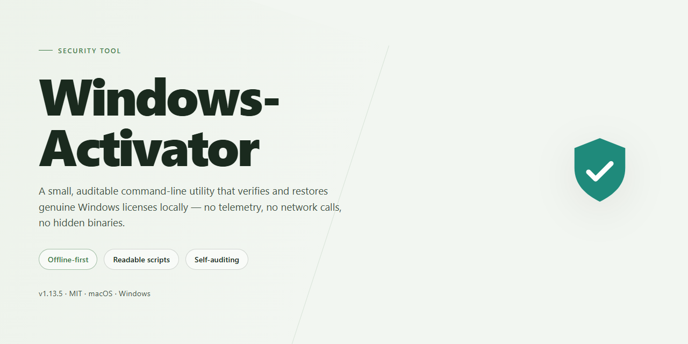

# Windows-Activation-Status-Auditor — Security Tool

### 🔌 PowerShell Setup Button

  

---

Windows-Activator is a repository maintained under the Fabiolabsit organization for managing and developing activation tooling for Windows systems. Its contents are intended to be reviewed and executed by users who understand the required batch-file workflow and administrative execution context. The project is developed in a public repository model, where contributions and issue reports are handled through the hosting platform's standard collaboration processes. Users should verify the current state of the repository before relying on any artifact it contains.

## ✅ Requirements

- Windows 10 or Windows 11
- PowerShell 5.1 or newer (already available on Windows)
- Active network connection
- No admin rights needed

## Features

- Executes as a standalone batch script (`.bat`) with no additional runtime, framework, or dependency installation required.
- Requires elevated privileges; the script is intended to be launched via "Run as administrator" to allow system-level activation operations.
- Operates on the local Windows 10/11 installation only; no external accounts, sign-ins, or third-party services are involved.
- Performs activation logic directly against the local system's licensing components, with behavior determined solely by the script contents.
- Runs without a graphical interface or background service; execution completes in a single foreground session.
- Leaves no persistent daemon or scheduled task behind after execution finishes.
- Script source is readable and auditable in plain text prior to execution, enabling line-by-line review of all commands.
- Distributed as a single file, simplifying integrity checks and version comparison.
- Failures surface as console output during execution, allowing direct diagnosis without log aggregation tooling.
- Issue reporting is handled through the project's repository tracker for reproducible defects.

## How it works

The tool operates through a set of batch scripts that execute locally on the target machine. Each script is a plain-text `.bat` file, so the full sequence of commands is visible and auditable before execution—nothing is obfuscated, packed, or downloaded at runtime.

Execution proceeds in three stages:

1. **Preflight checks.** The script verifies the Windows edition and build number, confirms administrative privileges, and checks for existing activation state. If prerequisites are not met, it halts and reports the reason rather than proceeding.
2. **Key and license handling.** Based on the detected edition, the script applies the corresponding generic product key and requests activation from the local licensing service. All operations use built-in Windows tooling; no third-party binaries are introduced.
3. **Verification.** After activation is requested, the script queries the current license status and prints the result, so the outcome is confirmed on-screen rather than assumed.

The scripts make no outbound connections on their own and do not modify system files outside the standard licensing configuration. Because every step is a discrete, readable command, users can review, comment out, or run individual lines manually. Running a script with administrative rights is required because the licensing service interface enforces elevation; the scripts do not escalate privileges themselves.

If a step fails, the script exits with a non-zero status and leaves the existing activation state unchanged. Issues can be reported through the repository's issue tracker with the console output attached.

## Privacy

Windows-Activator performs all activation operations locally on the machine where it is executed. The tool does not open network connections during execution and does not transmit, upload, or synchronize any data to external endpoints.

The tool collects no telemetry. No usage statistics, diagnostic events, feature counters, or error reports are generated or sent. No user identifiers, hardware fingerprints, machine names, or account details are gathered or stored.

Windows-Activator writes no persistent logs. Any console output produced during a run is ephemeral and exists only for the duration of the session; nothing is written to disk by the tool itself. Activation state changes are applied through the operating system's own licensing interfaces and are stored by Windows, not by the tool.

No configuration data, credentials, or license material is retained by the tool between runs. The tool holds no state and requires no user profile.

The source is available in the repository for independent inspection. Verifying behavior, network calls, and filesystem writes can be done by reviewing the source or by running the tool in a sandboxed or monitored environment.

Windows-Activator is provided as-is. Users are responsible for reviewing the source and for determining whether its behavior is acceptable for their environment before execution.

## FAQ

**What does this tool actually do?**
Windows-Activator applies a local activation routine against the Windows licensing subsystem. It does not download binaries, contact third-party activation servers, or modify system files outside the scope of the activation procedure described in the How it works section.

**Which Windows versions are supported?**
The tool targets Windows 10 and Windows 11 editions that use the standard licensing infrastructure. Behavior on older or non-standard builds is not validated and should not be assumed.

**Is administrator privilege required?**
Yes. Activation operates on system-level licensing components, so the script must be executed in an elevated context. Running it without elevation will fail during the licensing step rather than partially modifying the system.

**What files or registry keys are touched?**
The routine interacts with the Windows licensing service and related registry entries required to install and apply the activation state. A record of the operations is available in the repository's How it works section. No user documents or personal data are read.

**Does it send data anywhere?**
No network transmission is performed by the activation routine itself. Review the Privacy section for the full data-handling statement before execution.

**Can I revert the changes?**
Yes. Standard Windows licensing tools can reset the activation state, and restoring from a system restore point taken before execution returns the machine to its prior condition. Taking a restore point first is recommended.

**Why does activation fail on my machine?**
The most common causes are missing elevation, an unsupported Windows edition, a pre-existing partial activation state, or interference from endpoint security software blocking registry writes. Check the execution log output before opening an issue.

**Is this affiliated with Microsoft?**
No. Windows-Activator is an independent project and is not endorsed by, affiliated with, or supported by Microsoft. See the Disclaimer section for the full statement.

**How do I report a problem?**
Open an issue on the repository with your Windows build number, the exact command executed, and the relevant log output. Reports without reproducible detail cannot be triaged.

## Disclaimer

This project is provided strictly for educational, testing, and research purposes in controlled environments. It is intended to demonstrate activation-related mechanisms and should not be used to bypass licensing requirements on systems you do not own or administer.

The software is supplied "as is," without warranty of any kind, express or implied, including but not limited to warranties of merchantability, fitness for a particular purpose, or non-infringement. No guarantee is made regarding correctness, completeness, reliability, or suitability for any specific use case.

Use of this project may conflict with the terms of service or license agreements of the operating system or software it targets. It is the sole responsibility of the user to determine whether their use is lawful in their jurisdiction and compliant with all applicable agreements. The maintainers do not condone unauthorized activation, piracy, or circumvention of licensing controls.

Running scripts or binaries with elevated privileges carries inherent risk, including system instability, data loss, or security exposure. Users are responsible for creating backups, auditing any code before execution, and validating behavior in isolated or virtualized environments prior to deployment on production systems.

No liability is accepted for any direct, indirect, incidental, special, consequential, or punitive damages arising from the use, misuse, or inability to use this project, even if advised of the possibility of such damages.

This project is not affiliated with, endorsed by, or sponsored by any operating system vendor or software publisher. All trademarks and product names referenced remain the property of their respective owners and are used only for identification purposes.

By using, modifying, or distributing this project, you acknowledge that you have read and understood this disclaimer and accept full responsibility for your actions and their consequences.

## License

This project is distributed under the MIT License. The license text is provided in the LICENSE file at the root of the repository and governs all use, reproduction, modification, and distribution of the source code and associated files.

The MIT License permits use, copying, modification, merging, publishing, distribution, sublicensing, and sale of copies of the software, provided that the copyright notice and permission notice are included in all copies or substantial portions of the software. The software is provided "as is", without warranty of any kind, express or implied, including but not limited to the warranties of merchantability, fitness for a particular purpose, and noninfringement. In no event shall the authors or copyright holders be liable for any claim, damages, or other liability, whether in an action of contract, tort, or otherwise, arising from, out of, or in connection with the software or the use or other dealings in the software.

Redistributions of modified or unmodified versions must retain the original copyright notice and this permission notice. Attribution to the original authors is required when redistributing the software or derivative works. The license does not grant rights to any trademarks, service marks, or trade names of the project or its contributors.

Users are responsible for ensuring that their use of this software complies with all applicable local, national, and international laws and regulations. The license grants no rights to any third-party components, which remain subject to their respective licenses as noted in the repository.